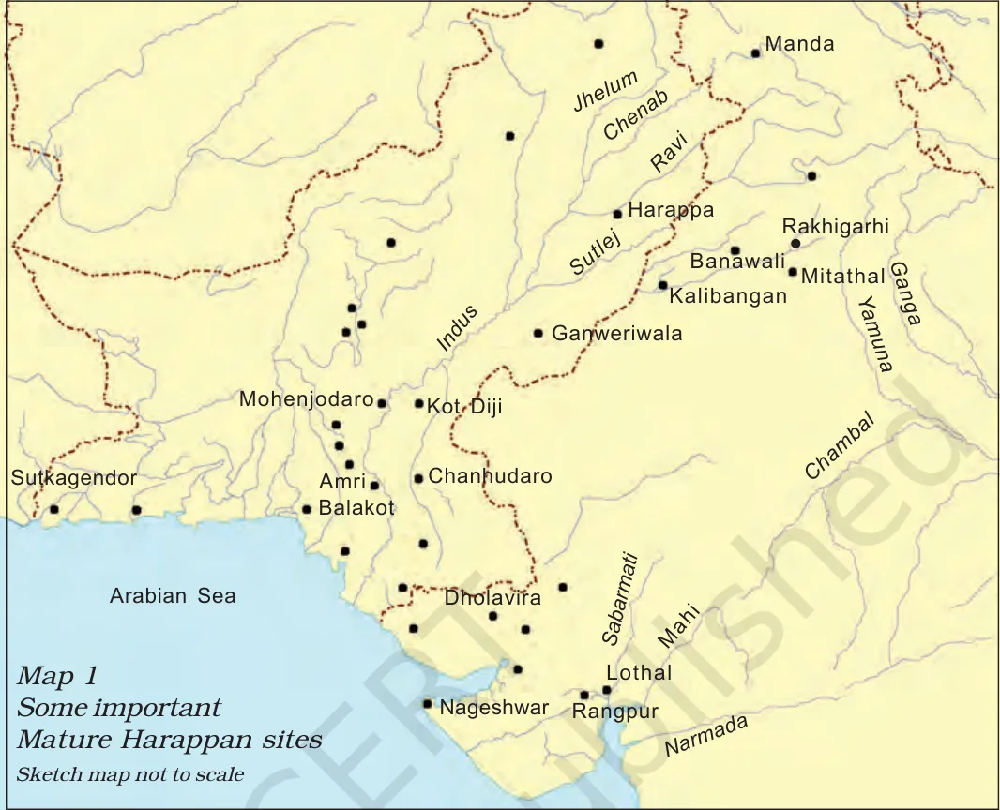
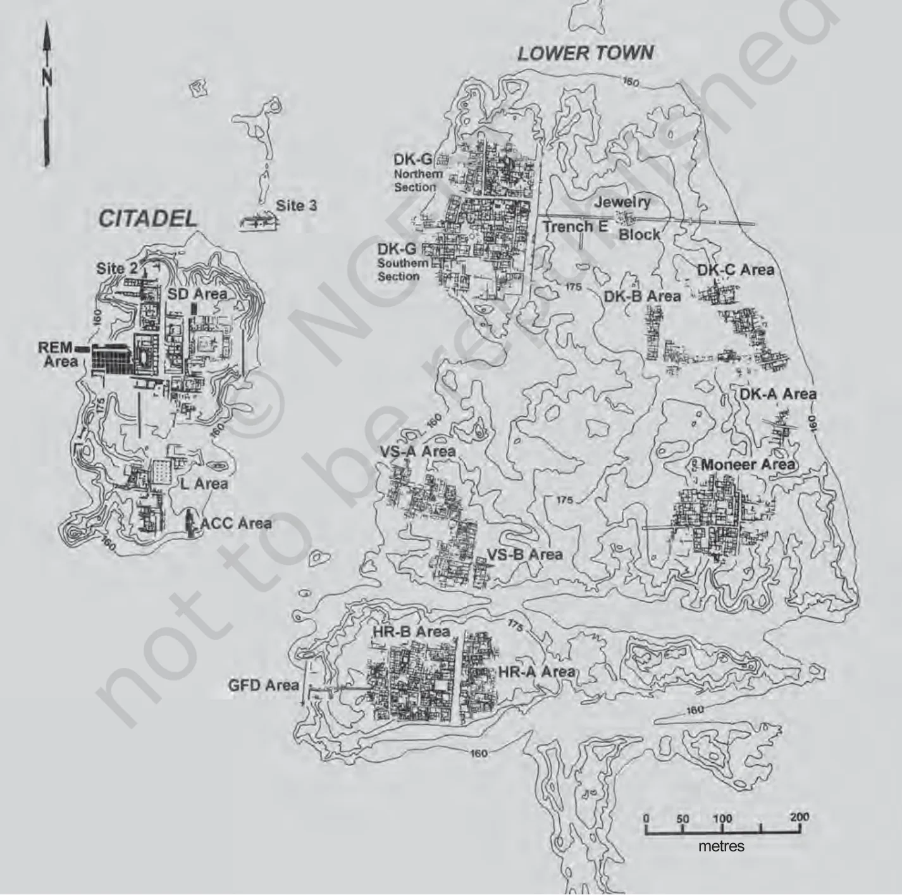
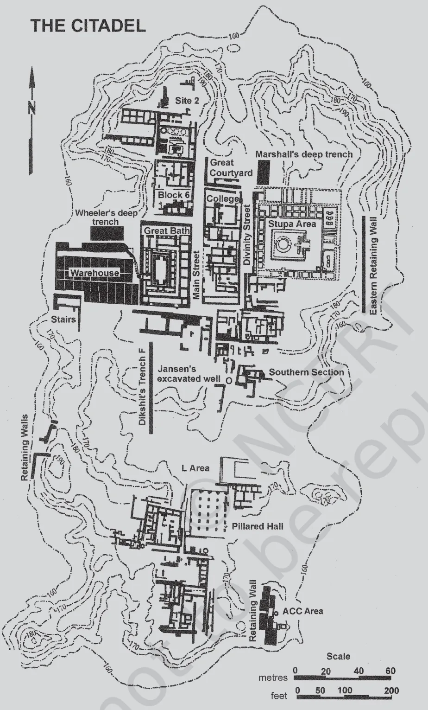
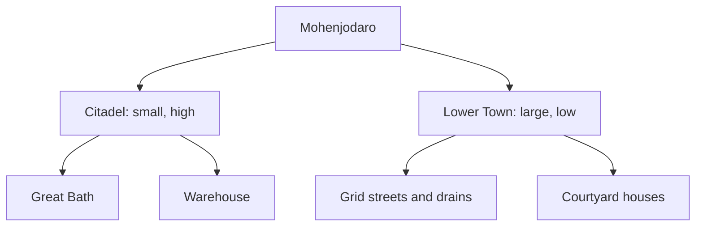
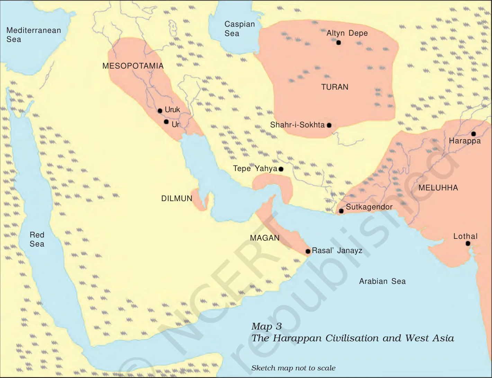
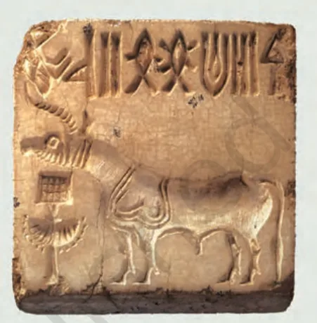
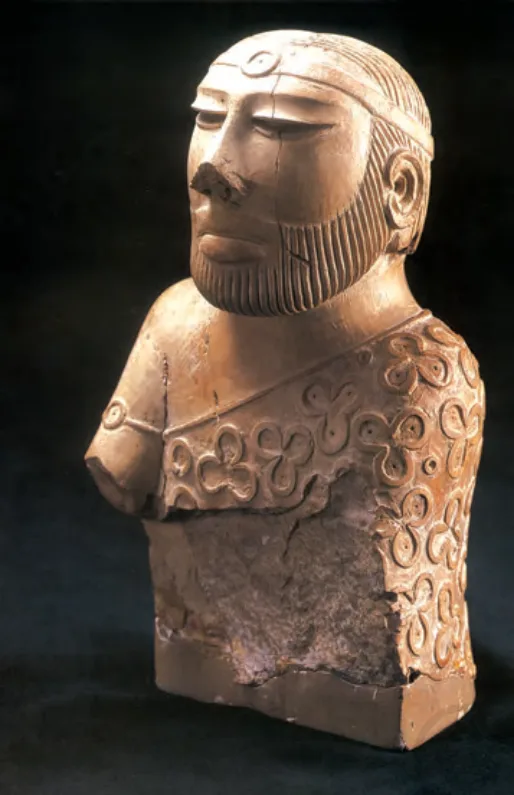
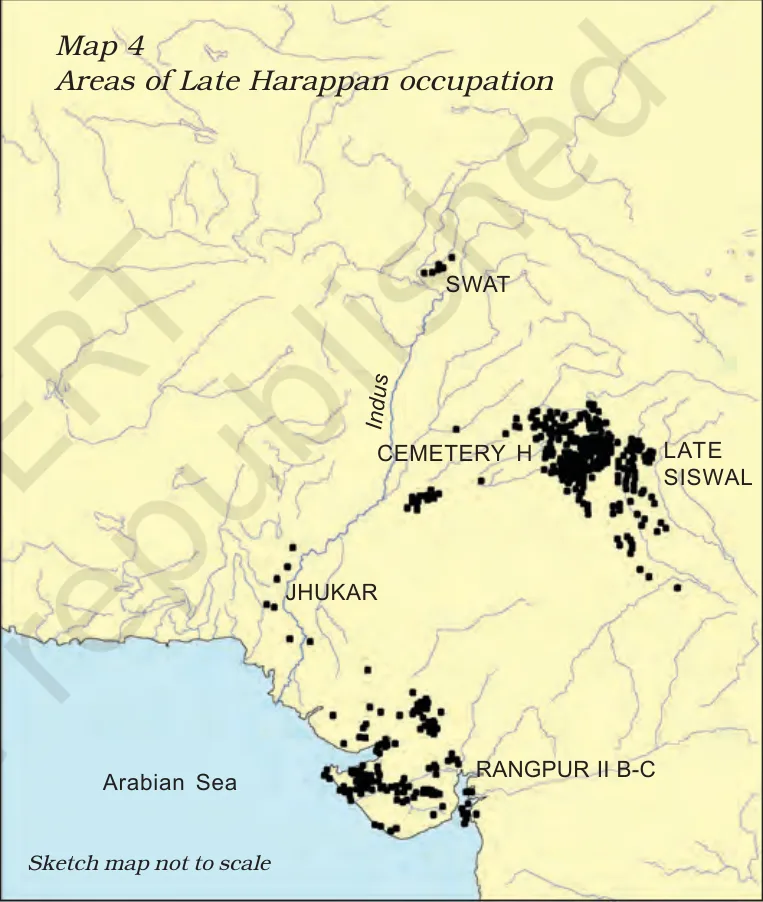

# Indus Valley Civilization and the Vedic age

## 1. Summary

- The Harappan (Indus Valley) civilisation was the first urban culture of the subcontinent. It is known **only from material remains**, because its script is undeciphered.
- Core facts to know: phases and dates, the five big cities, town planning (Citadel and Lower Town, grid streets, drains), crafts and long-distance trade, social differences, and the end of the civilisation.
- The Vedic age is known from **texts**, mainly the Rigveda (c. 1500–1000 BCE). The NCERT gives its religion and sacrifices but not a full social history.
- Exam use: no past question on this topic could be checked (see `_pyq-log.md`). Learn the facts as direct-fact questions; sites, dates and "who found what" are the likeliest.

---

## 2. Harappan civilisation

### 2.1 Names, dates and spread

- Also called the **Indus Valley Civilisation**. "Harappa" is the site where it was first identified.
- It spread over Afghanistan, Baluchistan, Sind and Punjab (Pakistan) and Jammu and Kashmir, Punjab, Haryana, Rajasthan, Uttar Pradesh, Gujarat and Maharashtra (India).
- More than **2000** sites are known. Most lie between the Indus and Saraswati basins; nearly **two-thirds** are in the **Saraswati basin**.
- The NCERT places the **beginnings** in farming communities dated about **7000 BCE**.

| Phase | Dates (NCERT) | Character |
|---|---|---|
| Early Harappan | 6000–2600 BCE | Formative; small settlements, no large buildings |
| Mature Harappan | 2600–1900 BCE | Urban phase; most prosperous |
| Late Harappan | 1900–1300 BCE | Decline; rural way of life |

> **Exam tip.** Older guides date the Mature phase about 2500–1750 BCE. The current NCERT says 2600–1900 BCE. If options show either, read them against the stem; prefer the NCERT dates.

### 2.2 The five major cities

- **Rakhigarhi** (Hisar district, Haryana): the **biggest** city, about **550 hectares**.
- **Mohenjodaro** (Sindh): about 125 hectares; best preserved.
- **Harappa** (Punjab, Pakistan): first site found; badly damaged by brick robbers.
- **Dholavira** (Gujarat).
- **Ganweriwala** (Cholistan).

> **Memory trick: R · M · H · D · G.** **R**akhigarhi, **M**ohenjodaro, **H**arappa, **D**holavira, **G**anweriwala.

*Map 1: Some important Mature Harappan sites. Source: NCERT Class 12, Themes in Indian History Part I, Ch 1, Map 1.*

### 2.3 Other important sites

| Site | Where | Known for |
|---|---|---|
| Lothal | Gujarat | Whole town fortified; drains of burnt brick; near carnelian, steatite and metal sources. Standard guides add: dockyard |
| Dholavira | Gujarat | Water reservoirs with fine masonry; a signboard of large signs |
| Kalibangan | Rajasthan | Ploughed field with **two sets of furrows**; fire altars |
| Chanhudaro | Sindh | Tiny craft centre (less than 7 ha): beads, shell, metal, seals, weights |
| Shortughai | Afghanistan | Near the source of **lapis lazuli**; traces of canals |
| Nageshwar, Balakot | Near the coast | Shell-working centres |
| Banawali | Haryana | Terracotta plough model |

### 2.4 Town planning (Mohenjodaro)

- Two parts: the smaller, higher **Citadel** and the larger, lower **Lower Town**. Both were walled.
- The Citadel stands on mud-brick platforms. Building the platforms alone needed an estimated four million person-days of labour, so the town was **planned first**.
- Streets formed a **grid** meeting at right angles. Drains were laid first, and houses built along them.
- **Bricks** (baked or sun-dried) had a standard ratio: length and breadth **four times and twice the height**.
- Houses faced an inner **courtyard**, had **no windows at ground level**, and each had a paved bathroom draining to the street drain. About **700 wells** have been estimated.
- Main drains were brick, set in mortar and covered with removable bricks (or limestone). House drains emptied into a **sump** before reaching the street drain.
- On the Citadel: a large **warehouse** and the **Great Bath**, a rectangular tank with steps on the north and south, made watertight with bricks on edge and **gypsum mortar**, probably used for a special ritual bath.
- At **Dholavira and Lothal** the whole settlement was fortified. At Lothal the Citadel was built high but not walled off.

*Layout of Mohenjodaro. Source: NCERT Class 12, Themes in Indian History Part I, Ch 1, Fig. 1.7.*

*Plan of the Citadel. Source: NCERT Class 12, Themes in Indian History Part I, Ch 1, Fig. 1.10.*

*In short: the Citadel held public buildings (Great Bath, warehouse); the Lower Town held houses on a street grid with drains.*

### 2.5 Economy

**Food and farming**
- Grains: **wheat, barley, lentil, chickpea, sesame**. Millets in Gujarat. Rice is rare.
- Animals kept: cattle, sheep, goat, buffalo, pig. Wild animal bones (boar, deer, gharial) and fish and fowl bones are also found.
- Plough evidence: terracotta plough models (Cholistan, **Banawali**) and the **Kalibangan** field. Oxen were probably used.
- Irrigation: traces of canals at Shortughai; wells; the reservoirs of Dholavira.

**Crafts**
- Beads were made of carnelian (red, from firing yellowish raw material), jasper, crystal, quartz, steatite, copper, bronze, gold, shell, faience and terracotta.
- **Steatite** is soft and easy to work; steatite micro beads are still a puzzle for archaeologists.
- Craft centres are identified by raw material, tools, unfinished objects, rejects and **waste**, which is one of the best indicators.
- **Faience** (ground sand or silica with colour and gum, then fired) was a costly material.

**Procuring raw materials**
- Settlements placed near sources: **Nageshwar, Balakot** (shell); **Shortughai** (lapis lazuli); **Lothal** (carnelian from Bharuch, steatite from south Rajasthan and north Gujarat, metal from Rajasthan).
- Expeditions: **Khetri** (Rajasthan) for copper (the Ganeshwar-Jodhpura culture supplied copper) and south India for gold.
- Copper also probably came from **Oman**; Omani copper and Harappan artefacts share traces of nickel.
- Transport: bullock carts (terracotta models), river routes along the Indus, and coastal routes.

**Contact with distant lands**
- Mesopotamian texts name **Dilmun** (probably Bahrain), **Magan** (probably Oman) and **Meluhha** (possibly the Harappan region), "a land of seafarers". Meluhha's products: carnelian, lapis lazuli, copper, gold, wood.
- A Harappan jar coated with black clay has been found in Oman. Harappan motifs appear on the "Persian Gulf" seal of Bahrain; local Dilmun weights followed the Harappan standard.

*Map 3: The Harappan civilisation and West Asia. Source: NCERT Class 12, Themes in Indian History Part I, Ch 1, Map 3.*

### 2.6 Seals, script and weights

- **Seals** were of **steatite**, usually with an animal motif and a line of writing. A seal pressed into wet clay made a **sealing**, which proved a bag was untampered and showed who sent it.
- The script is **undeciphered**. It was written **right to left**; about **375–400 signs**, so not alphabetical. The longest inscription has about 26 signs. Writing is found on seals, copper tools, jar rims, tablets, jewellery, bone rods and a **signboard**.
- **Weights**: cubical, of chert, no markings. Small weights were **binary** (1, 2, 4, 8, 16, 32); higher ones **decimal** (160, 200, 320, 640).

*A Harappan seal. Source: NCERT Class 12, Themes in Indian History Part I, Ch 1, Fig. 1.1.*

### 2.7 Society, authority and religion

- **Burials**: the dead were laid in pits, sometimes brick-lined. Jewellery is found with men and women. The Harappans did not bury precious things with the dead.
- **Social differences**: archaeologists separate **utilitarian** objects (querns, pottery, needles) found everywhere from **luxuries** (rare or costly materials, such as faience pots and gold) found mostly in Mohenjodaro and Harappa.
- **Authority**: no clear palace or royal burial. The stone "**priest-king**" was named by analogy with Mesopotamia. Views differ: no rulers; several rulers; or a single state.
- **Religion** (all speculative): terracotta female figurines as "mother goddesses"; the **Great Bath** and fire altars at Kalibangan and Lothal as ritual structures; a seated figure on a seal as "**proto-Shiva**"; conical stones as lingas. The "proto-Shiva" idea does not match **Rudra** of the Rigveda, who is not shown as Pashupati or a yogi.

*The "priest-king". Source: NCERT Class 12, Themes in Indian History Part I, Ch 1, Fig. 1.23.*

### 2.8 The end of the civilisation

- By about **1800 BCE** most Mature Harappan sites in regions such as Cholistan were abandoned; people moved to Gujarat, Haryana and western Uttar Pradesh.
- Late Harappan sites lost **seals, script, weights, special beads, long-distance trade and craft specialisation**. A rural way of life remained.
- Suggested reasons: climate change, deforestation, floods, shifting or drying rivers, overuse of land. None explains the fall of the whole civilisation. A strong unifying element, perhaps the Harappan state, came to an end.
- **Invasion theory**: R.E.M. Wheeler (1947) linked skeletons at Mohenjodaro to the Rigvedic fort-destroyer Indra. **G.F. Dales** (1964) showed the skeletons were from different periods and there was no sign of burning or defence. The "massacre" is now doubted.
- **DNA study** at Rakhigarhi (Vasant Shinde and team, 2019): the Harappans were **indigenous**, with genetic continuity to present-day South Asians.

*Map 4: Areas of Late Harappan occupation. Source: NCERT Class 12, Themes in Indian History Part I, Ch 1, Map 4.*

### 2.9 Discovery (timeline)

| Date | Event |
|---|---|
| Mid-19th century | Cunningham, first Director-General of the ASI, notes a Harappan seal but misses its age |
| Early 20th century | Daya Ram Sahni finds seals at Harappa; Rakhal Das Banerji finds similar seals at Mohenjodaro |
| 1924 | John Marshall announces the discovery of a new civilisation |
| 1944 onwards | R.E.M. Wheeler introduces digging by layers (stratigraphy) |
| 1955 | S.R. Rao begins excavations at Lothal |
| 1960 | B.B. Lal and B.K. Thapar begin excavations at Kalibangan |
| 1990 | R.S. Bisht begins excavations at Dholavira |

> **Guide dates.** Many guides give Harappa 1921 (Daya Ram Sahni) and Mohenjodaro 1922 (R.D. Banerji). They fit the NCERT timeline order but the PDF text of that timeline is jumbled, so treat as likely, not certain.

---

## 3. The Vedic age

- **Sources**: texts, not excavations. The **Rigveda** is the earliest known text, compiled **c. 1500–1000 BCE**.
- **Periods** (NCERT timeline): early Vedic traditions c. 1500–1000 BCE; later Vedic traditions c. 1000–500 BCE.
- The Rigveda is made of hymns to **Agni, Indra and Soma**. They were chanted at sacrifices, where people prayed for cattle, sons, good health and long life.
- Hymns were in **Vedic Sanskrit** and taught **orally** to men of priestly families.
- Sacrifice: first **collective**; later (c. 1000–500 BCE) some were performed by **heads of households**. Kings and chiefs performed elaborate sacrifices such as the **rajasuya** and **ashvamedha**, depending on Brahmana priests.
- **Flexibility** in early Vedic society: a Rigvedic hymn describes a family where the speaker is a poet, his father a physician and his mother a grinder of grain.
- **Upanishads** (from c. 6th century BCE): questions about the self, life after death and rebirth.
- **Rudra** of the Rigveda is the name later used for Shiva.
- The NCERT notes that some scholars hold the Harappans and the Vedic people to be the same, and that more research is needed.

**Guide (not in NCERT chapters):** the Rigveda has **10 mandalas** and about **1028 hymns**; **Sabha and Samiti** were the people's assemblies; the later Vedic period had four varnas.

> **Memory trick: R · S · Y · A.** The four Vedas: **R**ig, **S**ama, **Y**ajur, **A**tharva. Rig is the oldest.

---

## 4. Timeline

| Date | Event |
|---|---|
| c. 7000 BCE | Early farming communities (NCERT: origin of Harappan culture) |
| 6000–2600 BCE | Early Harappan |
| 2600–1900 BCE | Mature Harappan |
| c. 1800 BCE | Most Mature Harappan sites abandoned |
| 1900–1300 BCE | Late Harappan |
| c. 1500–1000 BCE | Early Vedic traditions; Rigveda |
| c. 1000–500 BCE | Later Vedic traditions |

---

## 5. Remember this

1. Mature Harappan = **2600–1900 BCE** (NCERT).
2. Five cities: **Rakhigarhi** (biggest, 550 ha), Mohenjodaro, Harappa, Dholavira, Ganweriwala.
3. **Citadel** = small, high, public buildings; **Lower Town** = large, low, houses.
4. Bricks 4 : 2 : 1; grid streets; covered drains; houses with courtyards and no ground-level windows.
5. Script **undeciphered**, right to left, 375–400 signs. Seals of **steatite**.
6. **Meluhha** = probably the Harappan region (Mesopotamian texts).
7. Rigveda c. 1500–1000 BCE: **Agni, Indra, Soma**.

## 6. Common confusions

| Pair | How to tell them apart |
|---|---|
| Harappa vs Mohenjodaro | Harappa: first found, badly robbed. Mohenjodaro: best preserved; Great Bath |
| Citadel vs Lower Town | Citadel: small, high, walled public buildings. Lower Town: large, low, houses |
| Utilitarian vs luxury | Utilitarian: querns, pottery, needles. Luxury: rare or costly (faience, gold) |
| Dilmun, Magan, Meluhha | Bahrain (probably), Oman (probably), Harappan region (possibly) |
| Rudra vs "proto-Shiva" | The seal figure does not match Rudra of the Rigveda |
| Early vs later Vedic | c. 1500–1000 BCE vs c. 1000–500 BCE |

## 7. Solved example (match the site)

**Question.** Match: A Dholavira, B Chanhudaro, C Shortughai, D Kalibangan with 1 near lapis lazuli source, 2 ploughed field with two sets of furrows, 3 small craft centre, 4 water reservoirs.

**Steps.**
1. Dholavira: reservoirs, so A-4.
2. Chanhudaro: tiny craft centre, so B-3.
3. Shortughai: lapis lazuli, so C-1.
4. Kalibangan: ploughed field, so D-2.

**Answer.** A-4, B-3, C-1, D-2.

## 8. Quick revision

- Names: Harappan = Indus Valley; Harappa first identified.
- Phases: 6000–2600 / 2600–1900 / 1900–1300 BCE.
- Cities: R M H D G; Rakhigarhi biggest.
- Plan: Citadel and Lower Town, grid, drains, 4:2:1 bricks, Great Bath.
- Crafts and trade: steatite, carnelian, faience; Khetri, Oman, Shortughai; Dilmun, Magan, Meluhha.
- Script: undeciphered, right to left; weights binary then decimal.
- End: about 1800 BCE; no single cause; DNA shows continuity.
- Vedic: Rigveda 1500–1000 BCE; Agni, Indra, Soma; rajasuya, ashvamedha.
