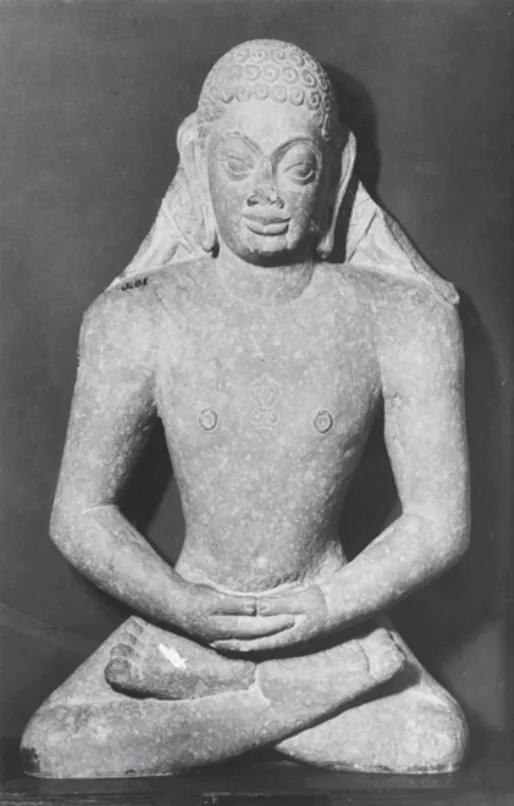
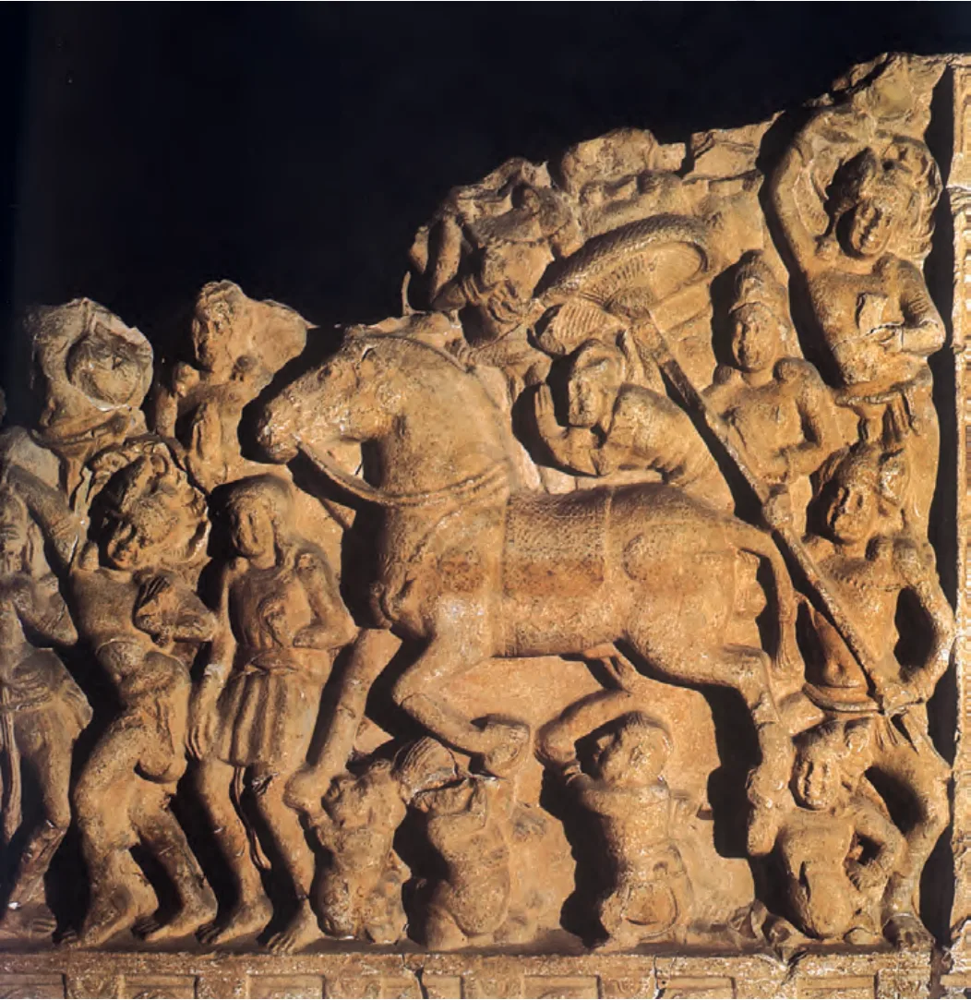
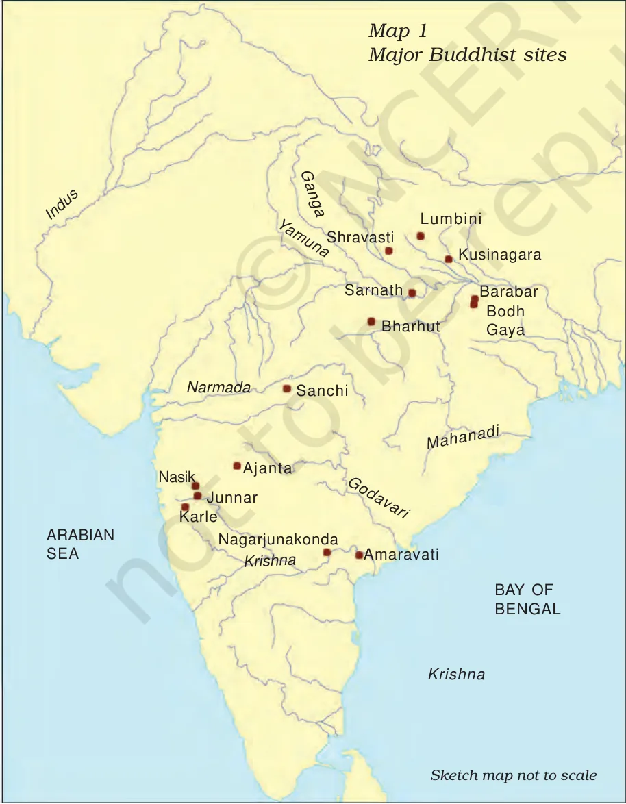
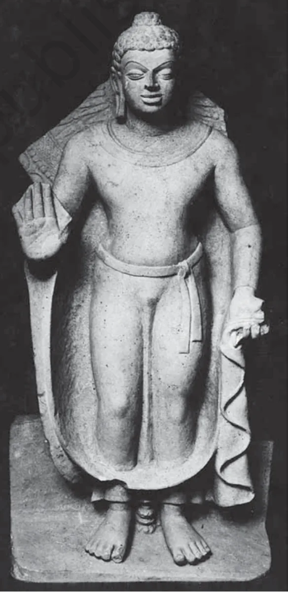

# Emergence of Buddhism and Jainism

## 1. Summary

- Around the **sixth century BCE** new thinkers appeared across the world. In India they included **Mahavira** (Jainism) and **Gautama Buddha** (Buddhism). Both questioned the authority of the **Vedas** and taught that individuals could work for their own liberation.
- Why now: new kingdoms and cities in the Ganga valley, changing social and economic life, and questions about sacrifice, rebirth and the nature of the self.
- Know: the Jaina and Buddhist teachings, key words in Pali, the three Pitakas, the sangha, the sacred places, the later **Mahayana** split, and the **stupas** that carried the tradition into art.

---

## 2. The background: sacrifices and debates

- **Vedic sacrifice** was one tradition. The Rigveda hymns ask the gods, especially Agni, for cattle, sons and long life.
- The **Upanishads** (c. sixth century BCE onwards) asked about the **self**, life after death and rebirth. Some outside the Vedic tradition asked whether there is any single ultimate reality.
- Buddhist texts mention as many as **64 sects or schools**. Teachers travelled and debated in a **kutagarashala** (hut with a pointed roof) or in groves. A philosopher who won a debate gained the rival's followers.
- Many teachers, including Mahavira and the Buddha, **questioned the Vedas** and stressed **individual agency**. This contrasts with the Brahmanical view in which a person's existence was set by birth in a caste or gender.
- Both Mahavira and the Buddha belonged to **ganas or sanghas**, the oligarchic states.

**Two other traditions (known only from Buddhist texts)**
| Tradition | Teacher | Belief |
|---|---|---|
| **Ajivikas** | Makkhali Gosala | Fatalists: everything is fixed; karma cannot be changed |
| **Lokayatas** | Ajita Kesakambalin | Materialists: no other world; the body returns to the four elements |

---

## 3. Jainism

### 3.1 Teachings
- The basic philosophy existed **before** Vardhamana, called **Mahavira**. He was preceded by **23 other tirthankaras** ("those who guide across the river of existence").
- **The whole world is animated**: even stones, rocks and water have life. So **non-injury (ahimsa)** to humans, animals, plants and insects is central. Ahimsa left a mark on Indian thought as a whole.
- Birth and rebirth are shaped by **karma**. **Asceticism and penance** free one from karma. This needs **renunciation**, so monastic life is a condition of salvation.
- Monks and nuns took **five vows**: no killing, no stealing, no lying, **celibacy**, and no property.

### 3.2 Texts and spread
- Teachings were recorded by disciples, often as **stories** that appealed to ordinary people. An example is the **Uttaradhyayana Sutta** (Prakrit), where queen Kamalavati urges her husband to renounce the world.
- Jainism spread to many parts of India. Jaina scholars wrote in **Prakrit, Sanskrit and Tamil**. Manuscripts were kept in libraries attached to temples.
- Some of the **earliest stone sculptures** of any religious tradition are of Jaina tirthankaras.

*A tirthankara from Mathura, c. third century CE. Source: NCERT Class 12, Themes in Indian History Part I, Ch 4, Fig. 4.5.*

**Guide (not in NCERT chapters):** Mahavira was the 24th tirthankara and Parshvanatha the 23rd; Mahavira added **brahmacharya** to Parshvanatha's four vows.

---

## 4. The Buddha

### 4.1 Life (as told in hagiographies)
- **Siddhartha**, son of a chief of the **Sakya** clan, grew up sheltered in a palace.
- On a visit to the city he saw an **old man, a sick man and a corpse**, and then a homeless **mendicant** who seemed at peace. He left the palace.
- After trying bodily mortification, which nearly killed him, he **meditated** and attained **enlightenment**. He was then the **Buddha** ("the Enlightened One"). He taught **dhamma** for the rest of his life.
- His death is placed at **c. fifth–fourth century BCE**.
- Hagiographies were written at least a century after his time; they tell us the beliefs of his followers and may not be literally accurate.

*Departure of the Buddha from his palace, Amaravati (Andhra Pradesh), c. 200 CE. Source: NCERT Class 12, Themes in Indian History Part I, Ch 4, Fig. 4.7.*

### 4.2 The four sacred places

| Event | Place |
|---|---|
| Birth | **Lumbini** |
| Enlightenment | **Bodh Gaya** |
| First sermon | **Sarnath** |
| Nibbana (death) | **Kusinagara** |

- About 200 years after the Buddha, **Asoka** put up a pillar at **Lumbini** to mark his visit.

> **Memory trick: L · B · S · K.** **L**umbini, **B**odh Gaya, **S**arnath, **K**usinagara, in life order.

*Major Buddhist sites. Source: NCERT Class 12, Themes in Indian History Part I, Ch 4, Map 1.*

### 4.3 Teachings
- The world is **transient (anicca)** and **soulless (anatta)**: nothing permanent or eternal. **Sorrow (dukkha)** is part of human life.
- Follow a **middle path** between severe penance and self-indulgence.
- The aim is **nibbana**: the extinguishing of ego and desire, ending the cycle of suffering.
- Stress on **metta** (fellow feeling) and **karuna** (compassion), especially for the younger and weaker.
- In the earliest Buddhism, whether god exists was **irrelevant**.
- The Buddha saw the social world as **made by humans**, not by god. He advised kings and **gahapatis** to be humane and ethical.
- He tried to persuade by **reason**, not miracles. When a grieving mother asked him to bring her child back, he led her to accept death.
- Reported last words: "**Be lamps unto yourselves**."
- He rejected claims of status by **birth**. A Buddhist dialogue (Avantiputta and Kachchana) shows that wealth, not varna, decides how people treat each other.
- **Social contract**: a Sutta Pitaka myth says people grew greedy and chose a **mahasammata** ("great elect") to keep order, paying him a share of rice. So kingship rests on human choice and taxes are payment for service.

---

## 5. The sangha

- The Buddha founded the **sangha**, an order of monks who taught dhamma. They lived simply on **alms**, so were called **bhikkhus**.
- At first only men; later **women** were admitted. According to Buddhist texts, **Ananda** persuaded the Buddha. His foster mother **Mahapajapati Gotami** was the first **bhikkhuni**. Women who reached liberation were called **theris**.
- Members came from kings, wealthy men and gahapatis to **workers, slaves and craftspeople**. Within the sangha **all were equal**.
- Decisions were taken by discussion, or a **vote** if that failed, following the traditions of ganas and sanghas.
- The **Vinaya Pitaka** laid down rules, for example limits on how many bowlfuls of food a monk may accept from a family.
- The **Therigatha** (part of the Sutta Pitaka) is a collection of verses by bhikkhunis. In one, **Punna**, a slave woman, argues with a Brahmana that bathing in water cannot free anyone from evil.

---

## 6. Buddhist texts

- The Buddha taught **orally**; nothing was written in his lifetime.
- After his death, elders compiled his teachings at a council at **Vaishali (Vesali)**. These were the **Tipitaka** ("three baskets"), first spoken, then written.

| Pitaka | Contents |
|---|---|
| **Vinaya** | Rules for the sangha |
| **Sutta** | The Buddha's teachings |
| **Abhidhamma** | Philosophical matters |

- Early texts are in **Pali**; later ones in Sanskrit. Chronicles of the island of Sri Lanka, the **Dipavamsa** and **Mahavamsa**, record regional Buddhist history.
- Chinese pilgrims **Fa Xian** and **Xuan Zang** came to India for texts and carried them to China, where they were translated.

> **Memory trick: V · S · A.** **V**inaya (rules), **S**utta (teachings), **A**bhidhamma (philosophy).

> **Guide.** Many books list four councils: **R**ajagriha, **V**aishali, **P**ataliputra (under Asoka), **K**ashmir (under Kanishka). The NCERT mentions only the council at Vaishali, so read the question carefully.

---

## 7. Stupas and sacred places (link to art)

- Places of special trees, rocks or beauty were early holy sites, called **chaityas**.
- A **stupa** (Sanskrit "heap") holds relics of the Buddha. The **Ashokavadana** says Asoka distributed relics to every important town and ordered stupas. By the **2nd century BCE** there were stupas at **Bharhut, Sanchi and Sarnath**.
- The Buddha is shown in early sculpture by **symbols**: an **empty seat or tree** (meditation and enlightenment), a **stupa** (death, mahaparinibbana), a **wheel** (first sermon at Sarnath).
- For full details on stupa parts and Sanchi and Amaravati, see `3 Mauryan and Gupta Empires.md`, section on art and architecture.

---

## 8. Later developments

### Mahayana (from the 1st century CE)
- Early Buddhism stressed **self-effort**, and the Buddha was a human being who reached nibbana by his own efforts.
- By the **first century CE** the idea of a **saviour** grew. **Bodhisattas** were compassionate beings who used their merit to **help others** rather than leave the world.
- **Worship of images** of the Buddha and Bodhisattas became important.
- This way of thinking was called **Mahayana** ("great vehicle"). Its followers called the older tradition **Hinayana** ("lesser vehicle"). The older school calls itself **Theravada** (followers of the **theras**, the old respected teachers).

*An image of the Buddha from Mathura, c. first century CE. Source: NCERT Class 12, Themes in Indian History Part I, Ch 4, Fig. 4.22.*

### Puranic Hinduism (similar ideas of a saviour)
- **Vaishnavism**: Vishnu is the chief god; ten **avatars** (forms taken to save the world from evil). **Shaivism**: Shiva is chief; symbolised by the **linga**.
- Worship of a chosen deity with **bhakti** (love and devotion).
- The **Puranas**, compiled by about the middle of the first millennium CE in simple Sanskrit verse, were meant to be read aloud to everyone, including women and Shudras.

---

## 9. Comparison

| Point | Jainism | Buddhism |
|---|---|---|
| Founder or teacher | Mahavira (24th tirthankara) | Gautama Buddha |
| Key idea | Ahimsa; everything has life | Middle path; nibbana |
| Practice | Penance; strict monastic life | Moderation; the sangha |
| Texts | Stories in Prakrit; later Sanskrit and Tamil | Tipitaka in Pali |

---

## 10. Timeline

| Date | Event |
|---|---|
| c. 6th century BCE | Mahavira; the Buddha; early Upanishads |
| c. 5th–4th century BCE | Death of the Buddha; council at Vaishali |
| c. 3rd century BCE | First stupas; Asoka's pillar at Lumbini; Barabar caves for Ajivikas |
| 2nd century BCE | Stupas at Bharhut, Sanchi, Sarnath |
| 1st century CE | Mahayana Buddhism develops |
| c. 3rd century CE | Earliest temples; Vaishnavism, Shaivism and goddess cults grow |

---

## 11. Remember this

1. Mahavira was preceded by **23 tirthankaras**; Jainism's core is **ahimsa**; **five vows**.
2. Buddha's four places: **Lumbini, Bodh Gaya, Sarnath, Kusinagara**.
3. **Anicca, anatta, dukkha**; middle path; goal **nibbana**.
4. **Sangha** members = bhikkhus; first bhikkhuni = **Mahapajapati Gotami**; Ananda helped.
5. **Tipitaka**: Vinaya, Sutta, Abhidhamma; early texts in **Pali**.
6. **Mahayana** = great vehicle; **Bodhisattas**; image worship; older school = Theravada.
7. Stupa symbols: **empty seat = meditation; stupa = mahaparinibbana; wheel = first sermon**.

## 12. Common confusions

| Pair | How to tell them apart |
|---|---|
| Mahayana vs Hinayana | Mahayana: Bodhisattas, image worship. Older school: self-effort; calls itself Theravada |
| Vinaya vs Sutta | Vinaya = rules for monks. Sutta = teachings |
| Ajivikas vs Lokayatas | Ajivikas: fatalists. Lokayatas: materialists |
| Bhikkhu vs theri | Bhikkhu = monk. Theri = respected woman who reached liberation |
| Jain vs Buddhist ideal | Jain: severe penance. Buddhist: middle path |
| Lumbini vs Sarnath | Lumbini = birth. Sarnath = first sermon |

## 13. Solved example (arrange in order)

**Question.** Arrange these events of the Buddha's life in order: first sermon, birth, enlightenment, nibbana.

**Steps.**
1. Birth is at **Lumbini**.
2. Enlightenment is at **Bodh Gaya**.
3. First sermon is at **Sarnath**.
4. Nibbana is at **Kusinagara**.

**Answer.** Birth, enlightenment, first sermon, nibbana (L, B, S, K).

## 14. Quick revision

- Sixth century BCE thinkers questioned the Vedas; 64 sects were known.
- Jainism: 23 earlier tirthankaras; everything has life; ahimsa; five vows.
- Buddha: Sakya clan; saw old, sick, corpse, mendicant; middle path; nibbana.
- Anicca, anatta, dukkha; metta and karuna.
- Sangha: bhikkhus; women admitted; Mahapajapati Gotami first bhikkhuni.
- Tipitaka: Vinaya, Sutta, Abhidhamma; Pali.
- Stupas hold relics; early symbols for the Buddha.
- Mahayana: saviour idea, Bodhisattas, images; Vaishnavism and Shaivism similar.
