# Mauryan Empire and Gupta Empire

## 1. Summary

- Between c. 600 BCE and 600 CE the subcontinent saw **early states, towns, trade, coinage, new farming methods and new religions**. This note covers the mahajanapadas and Magadha, the **Mauryan Empire** (c. 321–185 BCE), the kingdoms that followed, and the **Gupta Empire** (c. 320 CE onwards).
- Historians use **inscriptions, coins, texts, sculpture and monuments**. Asoka's inscriptions are among the most valuable sources.
- The syllabus asks for four things in each empire: **administration**, **socio-economic** conditions, **religious** conditions, and **art, architecture and literature**. They are organised in that order below.
- Exam use: no past question on this topic could be checked (see `_pyq-log.md`). Expect direct facts: rulers, capitals, inscriptions, travellers, books and their authors.

---

## 2. The rise of states

### 2.1 Sixteen mahajanapadas
- The **sixth century BCE** is a turning point: early states, cities, growing use of **iron**, coinage and new systems of thought (Buddhism, Jainism).
- Buddhist and Jaina texts name **sixteen states** called **mahajanapadas**. Lists differ; **Vajji, Magadha, Koshala, Kuru, Panchala, Gandhara and Avanti** appear most often.
- Most were kingdoms. Some were **ganas or sanghas**, oligarchies in which power was shared by many men, called **rajas**. The Vajji sangha is an example; Mahavira and the Buddha belonged to such states.
- Each had a **fortified capital**. The Dharmasutras (Sanskrit, from c. sixth century BCE) said rulers should ideally be Kshatriyas and should collect taxes from cultivators, traders and artisans. **Raids** on neighbours were accepted as a way to gain wealth. Some states had standing armies; others used peasant militia.

> **Memory trick: Very Many Kings Keep Powerful Great Armies.** **V**ajji, **M**agadha, **K**oshala, **K**uru, **P**anchala, **G**andhara, **A**vanti.

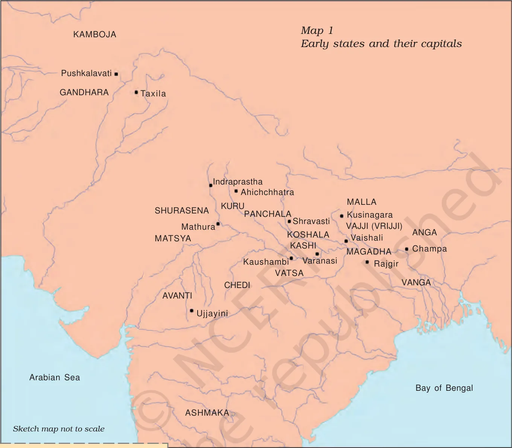

*Map 1: Early states and their capitals. Source: NCERT Class 12, Themes in Indian History Part I, Ch 2, Map 1.*

### 2.2 Why Magadha rose (6th–4th century BCE)
- Magadha (present-day Bihar) became the most powerful state.
- **Modern historians**: productive farmland, **iron mines** (Jharkhand), **elephants** from the forests, and the **Ganga** as a cheap route.
- **Early Buddhist and Jaina writers**: ambitious kings such as **Bimbisara, Ajatasattu and Mahapadma Nanda**, and their ministers.
- First capital: **Rajagaha (Rajgir)**, a fortified settlement among hills ("house of the king"). In the **fourth century BCE** the capital moved to **Pataliputra (Patna)** on the Ganga.

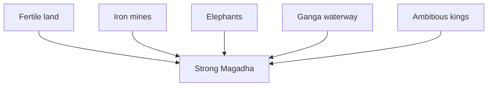

*In short: land, iron, elephants, river routes and ambitious kings together made Magadha the strongest state.*

---

## 3. The Mauryan Empire

### 3.1 Sources
- **Megasthenes**, a Greek ambassador at Chandragupta's court. His account survives in **fragments**.
- The **Arthashastra**, parts probably by **Kautilya or Chanakya**, traditionally Chandragupta's minister.
- Later **Buddhist, Jaina and Puranic** literature and Sanskrit works.
- **Archaeology**, especially sculpture.
- **Asoka's inscriptions** on rocks and pillars, often seen as the most valuable.

### 3.2 Rulers

| Ruler | Facts |
|---|---|
| **Chandragupta Maurya** | Founded the empire, **c. 321 BCE**; extended control to Afghanistan and Baluchistan |
| **Asoka** | His grandson; reign **c. 272/268–231 BCE**; conquered **Kalinga** (coastal Orissa) |
| End | The empire ended **c. 185 BCE**; it lasted about **150 years** |

Guide: Bindusara was between them; the last king, Brihadratha, was killed by Pushyamitra Shunga.

### 3.3 Administration
- **Five major political centres**: the capital **Pataliputra** and provincial centres **Taxila, Ujjayini, Tosali and Suvarnagiri**, all named in Asokan inscriptions.
- Control was **strongest around the capital and provincial centres**. Taxila and Ujjayini lay on long-distance trade routes; **Suvarnagiri** ("golden mountain") may have helped tap the gold mines of Karnataka.
- A **uniform administrative system** over so diverse a land was unlikely: the same message appears from the north-west to Andhra Pradesh, Orissa and Uttarakhand, but rule was not equally deep everywhere.
- **Communication** along land and river routes was vital; journeys from centre to province could take weeks or months, so provisions and protection were arranged. The **army** was important for protection.
- **Megasthenes**: a committee with **six subcommittees** for military work: navy; transport and supplies; foot-soldiers; horses; chariots; elephants. Officials also measured land, inspected canals and sluices, collected taxes, and supervised woodcutters, carpenters, blacksmiths and miners.
- **Army size** (Greek sources): 600,000 foot-soldiers, 30,000 cavalry, 9,000 elephants. Some historians think this is exaggerated.
- **Pativedakas** (reporters) were to report to the king on the people's affairs at all times. Asoka says earlier kings had no such arrangement.
- **Asoka's dhamma**: respect for elders, generosity to Brahmanas and renouncers, kind treatment of slaves and servants, respect for other religions. **Dhamma mahamattas** were officers appointed to spread it. It was meant to hold the empire together.
- Guide: provinces were governed by princes or officers; the king had a large army and a spy network.

### 3.4 Asoka's inscriptions

- Asoka was the **first ruler to inscribe his messages** to subjects and officials on natural rocks and polished pillars.
- Language and script: mostly **Prakrit in Brahmi**. In the north-west some are in **Kharosthi**; in Afghanistan some are in **Aramaic and Greek**.
- He used the titles **Devanampiya** ("beloved of the gods") and **Piyadassi** ("pleasant to behold"). The name Asoka appears in only a few inscriptions.
- **Kalinga inscription**: Asoka says **150,000** people were deported and **100,000** killed in the conquest, and that he felt remorse and turned to dhamma. It has **not been found in Kalinga itself**.
- Asokan sites in the south include **Brahmagiri, Siddapur, Maski, Rajula Mandagiri, Palkigundu** (Map in NCERT). Guide: Erragudi in Kurnool district is an Andhra site.

| Script | Where used |
|---|---|
| **Brahmi** | Most Prakrit inscriptions |
| **Kharosthi** | North-west |
| **Aramaic and Greek** | Afghanistan |

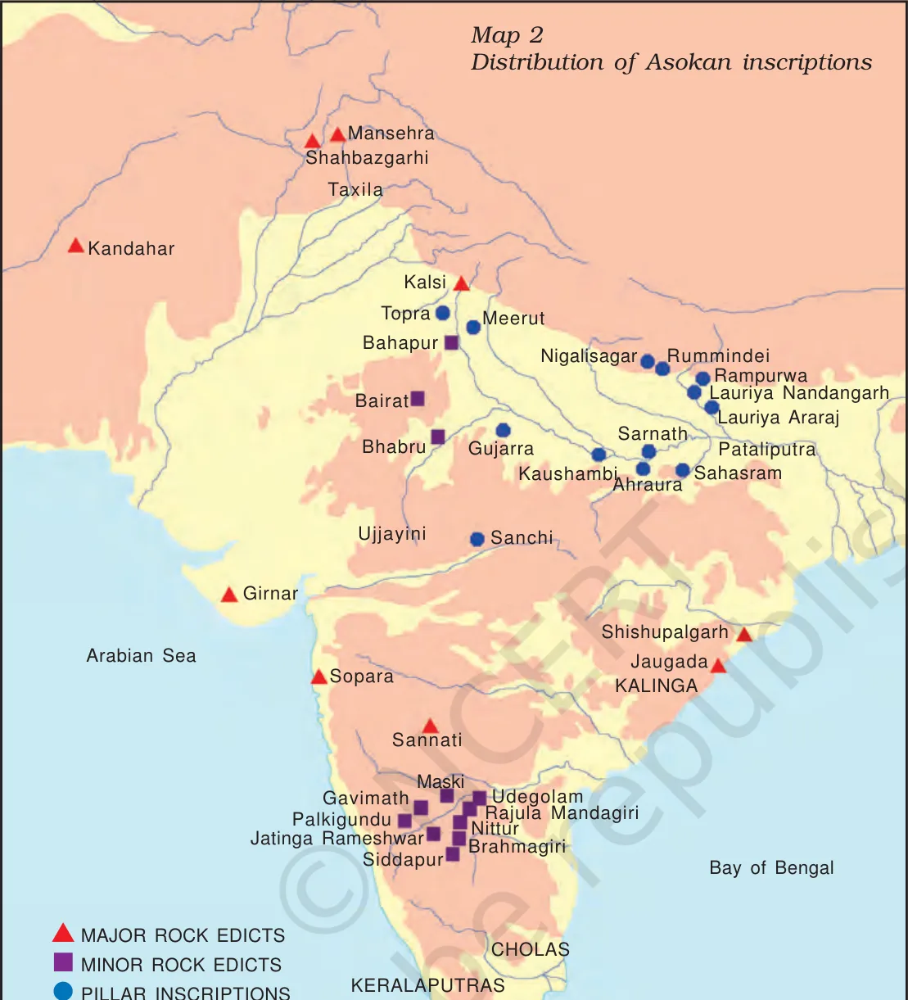

*Map 2: Distribution of Asokan inscriptions. Source: NCERT Class 12, Themes in Indian History Part I, Ch 2, Map 2.*

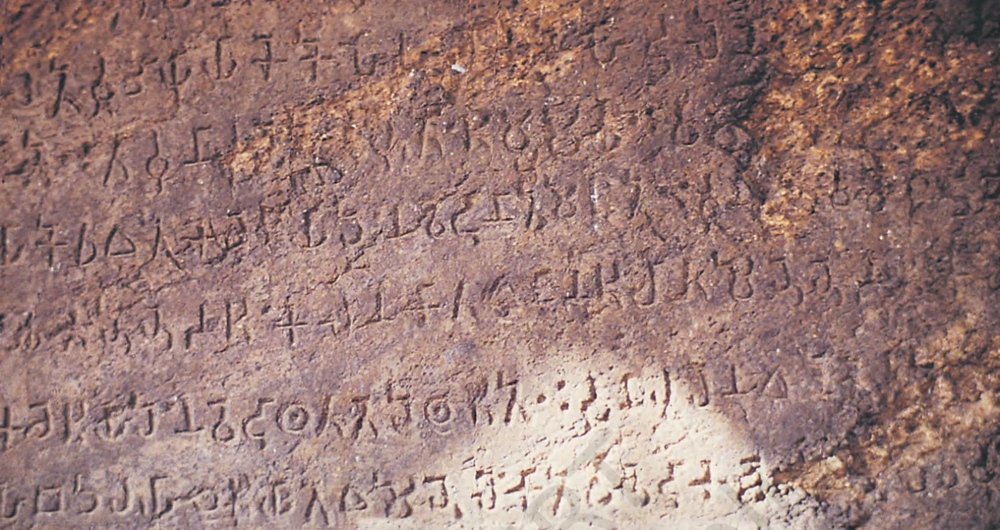

*An Asokan inscription. Source: NCERT Class 12, Themes in Indian History Part I, Ch 2, Fig. 2.10.*

### 3.5 How inscriptions were read
- Most Indian scripts descend from **Brahmi**. From the late eighteenth century European scholars and Indian pandits compared old letters with Bengali and Devanagari manuscripts.
- **James Prinsep**, an officer in the East India Company's mint, **deciphered Asokan Brahmi in 1838** and also read Kharosthi.
- **Kharosthi** was read with help from **Indo-Greek coins** that give royal names in both Greek and Kharosthi (for example Apollodotus, Menander).
- Prinsep found most inscriptions named **Piyadassi**; a few also named **Asoka**, known from Buddhist texts. This linked the king and his inscriptions.

### 3.6 How important was the empire?
- 19th and 20th century Indian historians saw it as a major landmark and Asoka as an inspiring figure for nationalists.
- But it lasted only about **150 years**, did not cover the whole subcontinent, and control was uneven. New chiefdoms and kingdoms rose in the second century BCE.

---

## 4. Kingdoms between the Mauryas and the Guptas

| Group | Where and when | Notes |
|---|---|---|
| **Indo-Greeks** | North-west, c. 200–100 BCE | First coins with **names and images of rulers**; Menander |
| **Shakas** | North-west and west, c. 100 BCE–200 CE | Central Asian origin; **Rudradaman** repaired the **Sudarshana lake** (Girnar, Gujarat); his inscription is among the earliest in Sanskrit |
| **Kushanas** | c. 1st century BCE–1st century CE | Vast kingdom from Central Asia to north-west India; title **devaputra** ("son of god"); colossal statues at **Mat** near Mathura; the **largest hoards of gold coins** |
| **Satavahanas** | Western and central India, c. 2nd century BCE–2nd century CE | Revenues from long-distance trade; claimed Brahmana status |
| **Cholas, Cheras, Pandyas** | **Tamilakam** (Tamil Nadu, parts of Andhra Pradesh and Kerala) | Chiefdoms described in **Sangam texts**; stable and prosperous |

- A **chief** may or may not be hereditary; he leads in ritual and war, arbitrates, and **receives gifts** that he redistributes. A **king** collects taxes and has regular officials and armies.
- **Divine kingship**: kings claimed high status by linking themselves to gods. The Kushanas did this most clearly, in coins and sculpture.
- Many states relied on **samantas**, men who lived off local land and gave homage and military help. Powerful samantas could become kings; weak kings could fall under them.

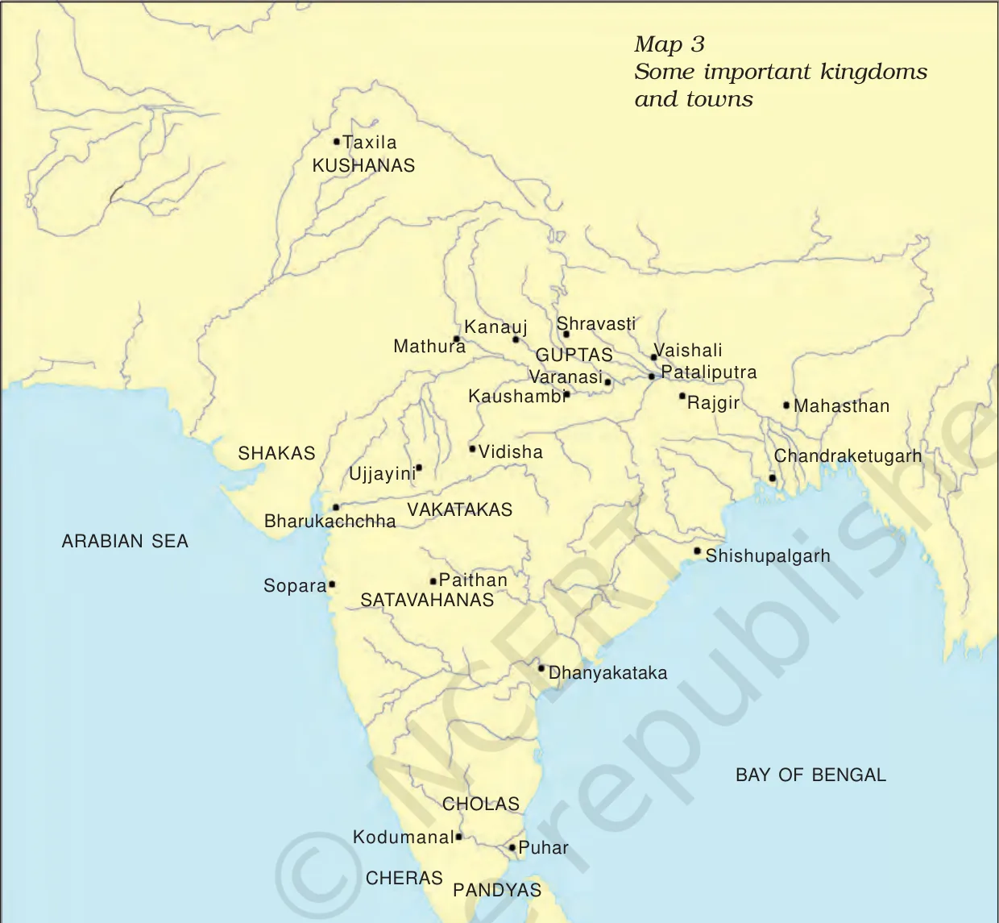

*Map 3: Some important kingdoms and towns. Source: NCERT Class 12, Themes in Indian History Part I, Ch 2, Map 3.*

---

## 5. The Gupta Empire

### 5.1 Timeline
| Date | Event |
|---|---|
| c. **320 CE** | Beginning of Gupta rule |
| c. **335–375 CE** | **Samudragupta** |
| c. **375–415 CE** | **Chandragupta II**; Vakatakas in the Deccan |
| 5th century | Chinese monk **Fa Xian** visits |
| c. 500–600 CE | Rise of Chalukyas in Karnataka and Pallavas in Tamil Nadu |

### 5.2 Sources and rulers
- Histories are rebuilt from **literature, coins and inscriptions**, including **prashastis** (poems in praise of kings).
- The **Prayaga Prashasti** (Allahabad Pillar Inscription), in Sanskrit, was composed by **Harishena**, the court poet of **Samudragupta**, "arguably the most powerful" Gupta. The text praises him as equal to the gods Kubera, Varuna, Indra and Yama. Prashastis were treasured as poetry and are not literal accounts.
- **Prabhavati Gupta**, daughter of **Chandragupta II**, married into the **Vakataka** family. Her inscription records a **land grant** of the village **Danguna** to the teacher Chanalasvamin. This is unusual: legal texts did not give women independent access to land, and she was a queen.
- Guide: **Chandragupta I** began the Gupta era and married a Licchavi princess; **Chandragupta II (Vikramaditya)** is linked with the golden age; **Kumaragupta I** with Nalanda; **Skandagupta** stopped the Huna invasions.

### 5.3 Gupta coins
- Some of the **most spectacular gold coins** were Gupta; early issues are **remarkably pure**.
- From about the **sixth century CE** finds of gold coins become fewer. Historians are **divided**: some say long-distance trade declined with the fall of the Western Roman Empire; others point to new towns and trade networks and say coins were in circulation, not hoarded.

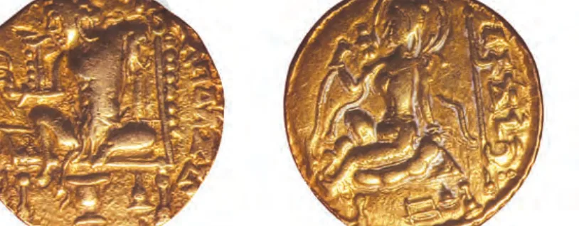

*A Gupta coin. Source: NCERT Class 12, Themes in Indian History Part I, Ch 2, Fig. 2.9.*

---

## 6. Socio-economic conditions (c. 600 BCE–600 CE)

### 6.1 Agriculture
- **Plough agriculture** with the **iron-tipped ploughshare** spread in fertile river valleys such as the Ganga and Kaveri from the sixth century BCE.
- **Transplantation** of paddy sharply raised yields in parts of the Ganga valley, but was back-breaking work.
- Semi-arid areas (parts of Punjab, Rajasthan) did not adopt the plough early; hilly regions of the north-east and centre used **hoe** agriculture.
- **Irrigation**: wells and tanks, less often canals. The **Sudarshana lake**, an artificial reservoir, was built under the Mauryas and repaired by Rudradaman (c. 2nd century CE) and again by a Gupta ruler (c. 5th century).
- Benefits were **uneven**. Pali texts use **gahapati** for the owner or head of a household; Tamil texts name **vellalar** (large landowners), **uzhavar** (ploughmen) and **adimai** (slaves).
- **Popular views of kings**: stories like the **Gandatindu Jataka** show subjects cursing a wicked king over high taxes and robbers, and fleeing to the forest.

### 6.2 Land grants
- From the early centuries CE, kings made **land grants**, often on **copper plates**, mostly to **Brahmanas and religious institutions**. The earliest inscriptional evidence is from c. 100–200 CE (Satavahana and Shaka rulers).
- An **agrahara** was land granted to a Brahmana, usually free of revenue and often with the right to collect dues. Prabhavati's grant lists many exemptions.
- Some historians say grants spread agriculture into new areas; others say they show kings **losing control** of samantas and trying to win allies.

### 6.3 Towns, crafts and guilds
- Towns appeared along **routes of communication**. Examples: **Pataliputra** (riverine), **Ujjayini** (land route), **Puhar** (coastal), **Mathura** (commercial and cultural centre). Pataliputra began as the village **Pataligrama**; Xuan Zang (7th century CE) found it in ruins.
- Finds: **Northern Black Polished Ware** (fine pottery of the rich) and ornaments, tools and figurines of gold, silver, copper, bronze, ivory, glass, shell and terracotta.
- Short **votive inscriptions** (c. 2nd century BCE) name donors: washerfolk, weavers, scribes, carpenters, potters, goldsmiths, blacksmiths, officials, merchants.
- **Guilds (shrenis)** of craftspeople and merchants procured raw materials, regulated production and sold the product.

### 6.4 Trade and coins
- Land and river routes crossed the subcontinent; sea routes crossed the Arabian Sea to East Africa and West Asia and the Bay of Bengal to Southeast Asia and China.
- **Spices (especially pepper), textiles and medicinal plants** were in high demand in the **Roman Empire**.
- The **Periplus of the Erythraean Sea** (anonymous Greek sailor, c. 1st century CE) lists Malabar coast exports: pepper, pearls, ivory, silk cloth, diamonds, sapphires, tortoise shell.
- Merchants were **masattuvan** (Tamil) or **setthis and satthavahas** (Prakrit).
- **Coins**: **punch-marked** silver and copper coins (from c. 6th century BCE) are among the earliest. Indo-Greeks issued the first coins with rulers' names and images; **Kushanas** the largest hoards of **gold coins** (c. 1st century CE), nearly identical in weight to Roman and Parthian coins; **Yaudheyas** (Punjab and Haryana) issued thousands of copper coins; the **Guptas** issued very pure gold coins. Hoards of Roman coins in south India show trade links.

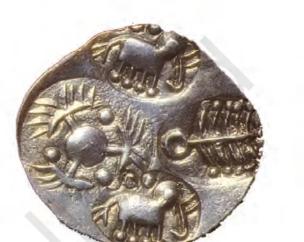

*A punch-marked coin. Source: NCERT Class 12, Themes in Indian History Part I, Ch 2, Fig. 2.7.*

### 6.5 Society: varna, jati and family
- The **Dharmasutras and Dharmashastras** (Sanskrit, from c. 500 BCE) laid down social norms; the **Manusmriti** was compiled between **c. 200 BCE and 200 CE**.
- **Four varnas**: Brahmanas (study, teach, sacrifice, gifts); Kshatriyas (warfare, protection, justice); Vaishyas (agriculture, pastoralism, trade); Shudras (assist the others). The number of **jatis** kept increasing; jatis with a common occupation formed **shrenis**.
- **Kings were not always Kshatriyas**: the Shungas and Kanvas (successors of the Mauryas) were Brahmanas; the Mauryas' origin is debated; Shakas were called **mlechchhas**. Gotami-puta Siri-Satakani, a Satavahana king, called himself a unique Brahmana.
- **Silk weavers of Mandasor** (c. 5th century CE inscription): a guild that migrated from Lata (Gujarat) and used its wealth to build a **sun temple**; members took up other occupations.
- **Patriliny** was the ideal; **exogamy** and **gotra** rules (a woman took her husband's gotra; same-gotra marriage barred). The **Satavahanas** show **metronymics** (names from mothers, e.g. Gotami-puta) but patrilineal succession, and practised **endogamy**.
- The Manusmriti lists **eight forms of marriage**, the first four "good". **Stridhana** (gifts at marriage) belonged to the woman.
- **Property**: land, cattle and money were generally controlled by men, though upper-class women (Prabhavati Gupta) could hold property.
- **Beyond the four varnas**: forest-dwellers (nishadas), nomadic pastoralists and others were seen as outside Brahmanical norms. **Chandalas** (who handled corpses and dead animals) were placed at the very bottom; Manusmriti required them to live outside the village. **Fa Xian** (5th century CE) and **Xuan Zang** (7th century) describe the treatment of "untouchables".
- **Alternative views**: Buddhists rejected status by birth; Tamil Sangam poems show chiefs expected to **share** wealth with bards.

---

## 7. Religious conditions

- **Vedic and Brahmanical**: sacrifices (rajasuya, ashvamedha), Brahmana priests, Dharmasutras.
- **Buddhism and Jainism** grew strongly in the same period (see `2 Emergence of Buddhism and Jainism.md`); **Ajivikas** and **Lokayatas** also existed. Asoka supported the Buddhist dhamma and cut caves at **Barabar** for **Ajivikas** (3rd century BCE).
- **Mahayana Buddhism** developed by the first century CE (Bodhisattas, image worship).
- **Puranic Hinduism**: **Vaishnavism** (Vishnu, ten avatars), **Shaivism** (Shiva, linga) and goddess cults; **bhakti**; the Puranas were compiled by about the middle of the first millennium CE. Vasudeva-Krishna was an important deity at Mathura.
- Kings mixed religion and power: Kushana rulers took divine titles; Gupta prashastis compared kings to gods.
- **Temples** to house images began around the time Sanchi was taking its form.

---

## 8. Art and architecture

### 8.1 Mauryan art
- Asoka's **polished stone pillars** with inscriptions; the **lion capital** (Sarnath; guide: it is India's national emblem).
- **Barabar caves** (Bihar), cut by Asoka's order in the 3rd century BCE for Ajivika renouncers.
- Early **stupas** (the tradition of building stupas may be older; Asoka had relics distributed and stupas built, per the Ashokavadana).
- **Sculpture** of the Mauryan period is cited as an example of imperial art.

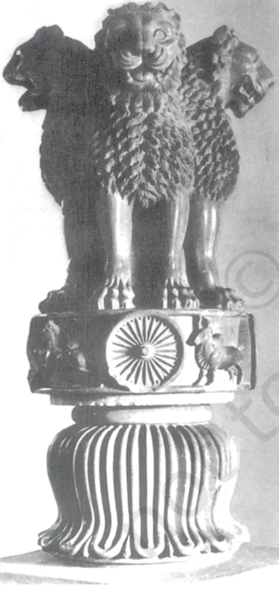

*The lion capital. Source: NCERT Class 12, Themes in Indian History Part I, Ch 2, Fig. 2.3.*

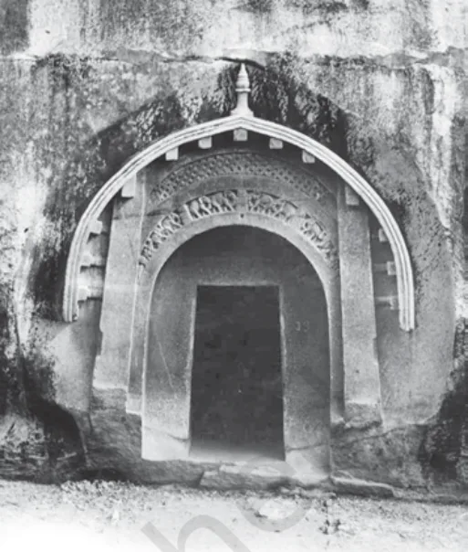

*Entrance to a cave at Barabar, Bihar, c. third century BCE. Source: NCERT Class 12, Themes in Indian History Part I, Ch 4, Fig. 4.27.*

### 8.2 Stupas
- A **stupa** (Sanskrit "heap") began as a simple **semi-circular mound of earth**, the **anda**. It grew into a structure balancing round and square: above the anda is the **harmika** (balcony for the abode of the gods); a mast, the **yashti**, rises from it, topped by a **chhatri** (umbrella). A **railing** separates sacred space from the world.
- Early stupas at **Sanchi and Bharhut** were plain except for **stone railings** (like wooden or bamboo fences) and richly carved **gateways** at the four cardinal points. Worshippers entered by the **east** gate and walked **clockwise**.
- Later stupas, as at **Amaravati** and Shah-ji-ki-Dheri (Peshawar), were carved all over.
- **Donors** recorded names on railings and pillars: kings (Satavahanas), guilds (for example **ivory workers** at Sanchi), and hundreds of women and men, including bhikkhus and bhikkhunis.

> **Memory trick: A · H · Y · C.** **A**nda, **H**armika, **Y**ashti, **C**hhatri.

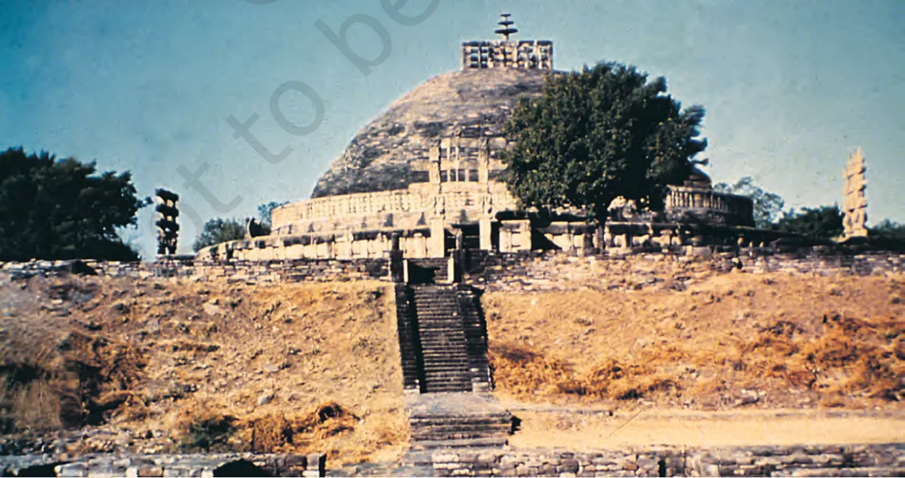

*The Great Stupa at Sanchi. Source: NCERT Class 12, Themes in Indian History Part I, Ch 4, Fig. 4.3.*

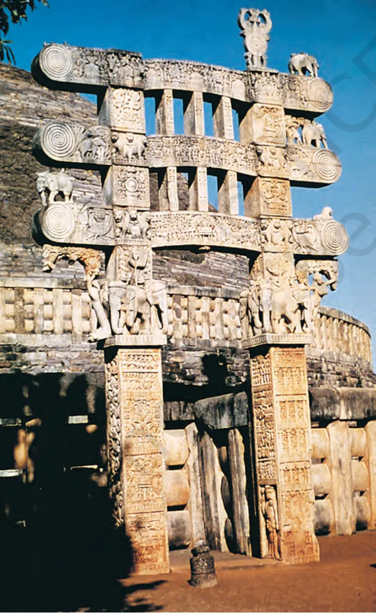

*The eastern gateway, Sanchi. Source: NCERT Class 12, Themes in Indian History Part I, Ch 4, Fig. 4.11.*

### 8.3 Sanchi and Amaravati: discovery and survival

| Point | Sanchi (Madhya Pradesh) | Amaravati (Andhra Pradesh) |
|---|---|---|
| Found | "Discovered" in **1818** | Ruins found **1796** by a local raja seeking stone for a temple |
| Early visitors | Cunningham examined it | **Colin Mackenzie** drew it; **Walter Elliot** (Guntur commissioner) removed panels to Madras in **1854** ("Elliot marbles") |
| Outcome | Survived: preserved **in situ**, helped by the **begums of Bhopal** (Shahjehan Begum, Sultan Jehan Begum); Marshall dedicated his volumes to Sultan Jehan | Slabs scattered to Calcutta, Madras and London; the mahachaitya is now a small mound |
| Status | **World Heritage Site, 1989** | |

- **H.H. Cole** argued against looting and for plaster casts in museums and originals kept in situ; his plea was accepted for Sanchi, not Amaravati.

### 8.4 Sculpture and painting
- Sculptors told **Jataka** stories (Vessantara Jataka) and showed the Buddha by **symbols**: empty seat or tree (meditation), **stupa** (mahaparinibbana), **wheel** (first sermon at Sarnath).
- **Popular motifs**: the **shalabhanjika** (a woman whose touch makes trees flower), serpents, animals (elephants for strength and wisdom), and a woman with elephants and lotuses, identified as Maya or **Gajalakshmi**.
- **Ajanta** (Maharashtra): cave paintings of Jataka stories and courtly life, with shading to give a 3D look.
- **Mathura** and **Gandhara** produced images of the Buddha and tirthankaras. Scholars found **Gandhara** images close to Greek models.
- **Temples**: the early temple was a small square room, the **garbhagriha**; later a **shikhara** rose above it. Examples: **Deogarh** (Uttar Pradesh, 5th century CE, with Vishnu on Sheshnag). **Rock-cut caves**: Barabar, and eventually the **Kailashnatha** temple at **Ellora** (8th century).

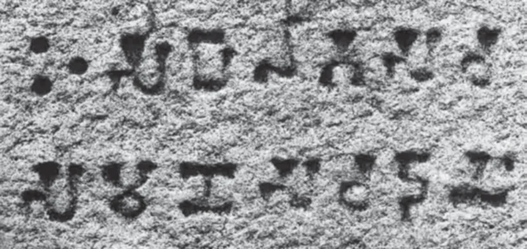

*A votive inscription from Sanchi. Source: NCERT Class 12, Themes in Indian History Part I, Ch 4, Fig. 4.9.*

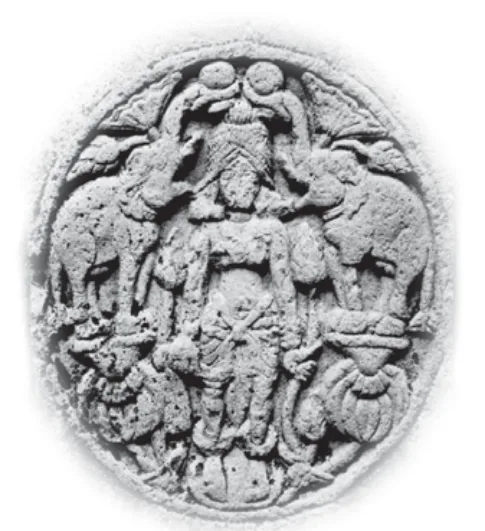

*Gajalakshmi. Source: NCERT Class 12, Themes in Indian History Part I, Ch 4, Fig. 4.19.*

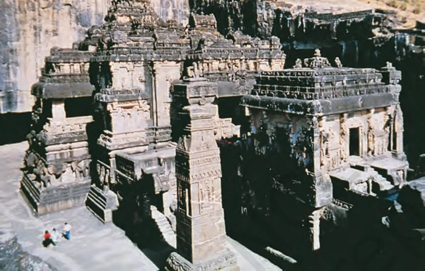

*Kailashnatha Temple, Ellora, carved from one rock. Source: NCERT Class 12, Themes in Indian History Part I, Ch 4, Fig. 4.28.*

---

## 9. Literature

| Text | About | Date or note |
|---|---|---|
| **Rigveda** | Hymns to Agni, Indra, Soma | c. 1500–1000 BCE |
| **Upanishads** | Self, rebirth | c. 6th century BCE onwards |
| **Ashtadhyayi** (Panini) | Sanskrit grammar | c. 500 BCE |
| **Dharmasutras / Dharmashastras** | Norms for society (Sanskrit) | From c. 500 BCE |
| **Mahabharata** | Epic of the Kuru cousins; Critical Edition (1919–66, 47 years) | Composed over c. 1000 years from c. 500 BCE |
| **Tipitaka** | Buddhist texts in Pali | After the Buddha's death |
| **Arthashastra** | Administration; Kautilya | Mauryan period |
| **Indica** | Account by Megasthenes | Mauryan period |
| **Jatakas, Panchatantra** | Popular tales; Jatakas in Pali | About the middle of the first millennium CE |
| **Manusmriti** | Legal text | c. 200 BCE–200 CE |
| **Sangam literature** | Tamil poems on chiefs; includes **Silappadikaram**, a Tamil epic (Pandya chief Senguttuvan) | NCERT dates it roughly first centuries CE |
| **Mrichchhakatika** (Shudraka) | Play; hero Charudatta is a Brahmana and merchant | c. 4th century CE |
| **Prayaga Prashasti** | Praise of Samudragupta by Harishena | 4th century CE |
| **Harshacharita** | Biography of Harsha by Banabhatta | c. 7th century CE |

Guide (not in NCERT chapters): Kalidasa (plays and poems); Aryabhata (*Aryabhatiya*) and Varahamihira (*Brihat Samhita*) in mathematics and astronomy; the Iron Pillar at Mehrauli, Delhi; Ajanta paintings; the Dashavatara temple at Deogarh; **dinara** gold coins.

> **Memory trick: "Mega-Kau-Hari-Bana".** **Mega**sthenes (*Indica*), **Kau**tilya (*Arthashastra*), **Hari**shena (*Prayaga Prashasti*), **Bana**bhatta (*Harshacharita*). Order of time: Mauryan, Mauryan, Gupta, Harsha.

---

## 10. Timeline

| Date | Event |
|---|---|
| c. 600–500 BCE | Paddy transplantation; urbanisation in the Ganga valley; mahajanapadas; punch-marked coins |
| c. 500–400 BCE | Magadhan rulers consolidate power |
| c. 327–325 BCE | Invasion of Alexander of Macedon |
| c. 321 BCE | Accession of Chandragupta Maurya |
| c. 272/268–231 BCE | Reign of Asoka |
| c. 200–100 BCE | Indo-Greeks in the north-west; Cholas, Cheras, Pandyas in the south; Satavahanas in the Deccan |
| c. 185 BCE | End of the Mauryan empire |
| c. 100 BCE–200 CE | Shaka rulers in the north-west; Roman trade; gold coinage |
| c. 100–200 CE | Earliest land grants (Satavahana and Shaka) |
| c. 320 CE | Beginning of Gupta rule |
| c. 335–375 CE | Samudragupta |
| c. 375–415 CE | Chandragupta II; Vakatakas in the Deccan |
| c. 500–600 CE | Chalukyas in Karnataka; Pallavas in Tamil Nadu |

---

## 11. Remember this

1. **Chandragupta Maurya c. 321 BCE; Asoka c. 272/268–231 BCE; Mauryan end c. 185 BCE.**
2. Mauryan sources: **Megasthenes** (*Indica*), **Arthashastra**, **Asoka's inscriptions**.
3. **Prinsep deciphered Brahmi in 1838**. **Piyadassi = Asoka.** Script: Brahmi (most), Kharosthi (north-west), Aramaic and Greek (Afghanistan).
4. Provincial centres: **Taxila, Ujjayini, Tosali, Suvarnagiri**; capital **Pataliputra**.
5. Gupta rule began **c. 320 CE**; **Samudragupta** (Prayaga Prashasti by **Harishena**); **Chandragupta II**; **Prabhavati Gupta** (Vakataka; Danguna grant).
6. Kushanas: **devaputra**, gold coins; Indo-Greeks: first coins with royal names.
7. Stupa: **anda, harmika, yashti, chhatri**; Sanchi survived, Amaravati did not.

## 12. Common confusions

| Pair | How to tell them apart |
|---|---|
| Rajagaha vs Pataliputra | Rajagaha: first Magadha capital, among hills. Pataliputra: later, on the Ganga |
| Megasthenes vs Arthashastra | Megasthenes: Greek ambassador's account. Arthashastra: Sanskrit text on administration |
| Brahmi vs Kharosthi | Brahmi: most Asokan inscriptions. Kharosthi: north-west |
| Harishena vs Banabhatta | Harishena: Samudragupta. Banabhatta: Harsha |
| Shakas vs Kushanas | Shakas: Rudradaman, Sudarshana lake. Kushanas: devaputra, Kanishka, gold coins |
| Fa Xian vs Xuan Zang | Fa Xian: 5th century CE (Gupta). Xuan Zang: 7th century CE (Harsha) |
| Sanchi vs Amaravati | Sanchi survived (in situ). Amaravati was looted (Elliot marbles) |
| Chief vs king | Chief: gifts, no regular army. King: taxes, officers, armies |

## 13. Solved example (arrange in order)

**Question.** Arrange: Beginning of Gupta rule, accession of Chandragupta Maurya, end of the Mauryan empire, reign of Asoka.

**Steps.**
1. Chandragupta Maurya: c. 321 BCE.
2. Asoka: c. 272/268–231 BCE.
3. End of Mauryan empire: c. 185 BCE.
4. Gupta rule: c. 320 CE.

**Answer.** Chandragupta Maurya, Asoka, end of the Mauryan empire, Gupta rule.

## 14. Quick revision

- Sixteen mahajanapadas; Magadha rose (land, iron, elephants, Ganga, kings); Rajagaha then Pataliputra.
- Mauryas: Chandragupta c. 321 BCE; Asoka; end c. 185 BCE; five centres; six army subcommittees; dhamma mahamattas.
- Inscriptions: Prakrit and Brahmi; Prinsep 1838; Kalinga: 150,000 deported, 100,000 killed.
- After the Mauryas: Indo-Greeks, Shakas, Kushanas, Satavahanas, Cholas-Cheras-Pandyas.
- Guptas c. 320 CE; Samudragupta and Harishena; Prabhavati Gupta, Danguna.
- Economy: iron plough, transplantation, irrigation, land grants, towns, guilds, Roman trade, gold coins.
- Society: four varnas, many jatis; patriliny; Satavahana endogamy; chandalas at the bottom.
- Art: Barabar caves, lion capital, stupas (A H Y C), Sanchi, Amaravati, Ajanta, early temples.
