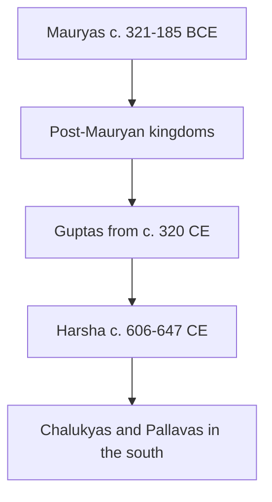

# Harshavardhana and his achievements

## 1. Summary

- **Harshavardhana** (Harsha) was king of **Kanauj** about **606–647 CE**. He is the last great ruler of ancient north India.
- What the **NCERT books in Books/** give: his reign dates and capital (timeline), the **Harshacharita** by his court poet **Banabhatta**, and the visit of the Chinese pilgrim **Xuan Zang** in search of Buddhist texts.
- Most other facts below come from **standard exam guides** and are marked **Guide**. They are not in the NCERT chapters in `Books/`; treat them as likely, not verified, until checked against a standard book (see `todo`).
- Exam use: no past question on this topic could be checked (see `_pyq-log.md`). Direct facts are likely: capital, court poet and book, the Chinese visitor, the rival who stopped him.

---

## 2. Facts from the NCERT books

| Fact | Detail |
|---|---|
| Reign | **c. 606–647 CE** |
| Kingdom | **Kanauj** |
| Court poet | **Banabhatta** (c. 7th century CE) |
| Book | **Harshacharita**, a **biography** of Harsha, in **Sanskrit** |
| Chinese pilgrim | **Xuan Zang** came **in search of Buddhist texts** |
| Neighbouring powers | **Chalukyas** (Karnataka) and **Pallavas** (Tamil Nadu) rose c. 500–600 CE |
| Soon after | The Arabs conquered **Sind**, c. **712 CE** |

### 2.1 The Harshacharita as a source
- The Harshacharita is a rare text that describes **life in a settlement on the outskirts of a forest in the Vindhyas**.
- Features: parcels of **rice-land, threshing grounds and arable land** shared out by small farmers; mainly **spade cultivation** (hard to plough sparse, grass-covered fields with black soil that is "stiff as black iron").
- People are seen carrying **bark, flowers, flax and hemp, honey, peacock-tail feathers, wax, logs and grass**; village women go to neighbouring villages to **sell forest fruits**.
- A **court poet's** work praises the king and cannot be read as plain history, but it is a valuable source.

### 2.2 Xuan Zang's observations (NCERT)
- Xuan Zang found **Pataliputra in ruins** with a very small population when he visited in the **seventh century CE**.
- He noted that **executioners and scavengers** were forced to live **outside the city**.

---

## 3. More about Harsha (standard guides)

**Guide: not in the NCERT chapters. Verify before relying on it.**

### 3.1 Family and rule
- Harsha belonged to the **Pushyabhuti** dynasty.
- **Kanauj** (Kannauj) was his capital.

### 3.2 Achievements
- **Literature**: Harsha wrote the plays **Ratnavali, Priyadarshika and Nagananda**.
- **Patron**: his court poet **Banabhatta** wrote the *Harshacharita*; (Banabhatta also wrote *Kadambari*).
- **Assembly**: he held a great assembly at **Prayag** (Allahabad) every **five years**, where he gave away wealth.
- **Visitor**: the Chinese pilgrim **Xuan Zang (Hiuen Tsang)** visited his court.
- **War**: **Pulakeshin II** of the **Chalukyas** stopped Harsha on the **Narmada** river, so Harsha could not conquer the Deccan.

### 3.3 Andhra link
- **Pulakeshin II** also won the **Vengi** region in Andhra. His brother **Kubja Vishnuvardhana** began the **Eastern Chalukya** line there (see Mains Paper I, AP history).

---

## 4. Flowchart: order of the main empires

*In short: Mauryas, then smaller kingdoms, then the Guptas, then Harsha at Kanauj; the Chalukyas and Pallavas rose in the south.*

---

## 5. Timeline

| Date | Event |
|---|---|
| c. 320 CE | Beginning of Gupta rule |
| c. 375–415 CE | Chandragupta II; Fa Xian visits in the 5th century |
| c. 500–600 CE | Chalukyas in Karnataka; Pallavas in Tamil Nadu |
| c. 606–647 CE | Harshavardhana, king of Kanauj; Xuan Zang visits |
| c. 712 CE | Arabs conquer Sind |

---

## 6. Memory trick

> **"Harsha K-B-X-P."** **K**anauj (capital), **B**anabhatta (court poet), **X**uan Zang (Chinese visitor), **P**ulakeshin II (stopped him on the Narmada).

The key letters match the four facts most likely to be asked. The order of the letters does not matter.

---

## 7. Remember this

1. Harsha: **Kanauj**, **c. 606–647 CE**.
2. **Banabhatta** wrote the **Harshacharita** (Sanskrit; a biography).
3. **Xuan Zang** visited, looking for **Buddhist texts**.
4. Guide: **Pulakeshin II** stopped him on the **Narmada**.
5. Guide: plays **Ratnavali, Priyadarshika, Nagananda**; assembly at **Prayag** every five years.

## 8. Common confusions

| Pair | How to tell them apart |
|---|---|
| Banabhatta vs Harishena | Banabhatta: Harsha (*Harshacharita*). Harishena: Samudragupta (*Prayaga Prashasti*) |
| Xuan Zang vs Fa Xian | Xuan Zang: 7th century, Harsha's time. Fa Xian: 5th century, Gupta times |
| Xuan Zang vs Megasthenes | Xuan Zang: Chinese Buddhist pilgrim. Megasthenes: Greek ambassador at Chandragupta Maurya's court |
| Harsha vs Samudragupta | Harsha: Kanauj, c. 606–647 CE. Samudragupta: Gupta king, c. 335–375 CE |
| Hiuen Tsang vs Xuan Zang | Same person; two spellings |

## 9. Solved example (who wrote what)

**Question.** Match: A Harishena, B Banabhatta, C Megasthenes, D Kautilya with 1 *Harshacharita*, 2 *Prayaga Prashasti*, 3 *Indica*, 4 *Arthashastra*.

**Steps.**
1. Harishena composed the praise poem of Samudragupta: A-2.
2. Banabhatta wrote on Harsha: B-1.
3. Megasthenes wrote *Indica*: C-3.
4. Kautilya: *Arthashastra*: D-4.

**Answer.** A-2, B-1, C-3, D-4.

## 10. Quick revision

- Harsha: Kanauj, c. 606–647 CE.
- Banabhatta and the *Harshacharita* (Sanskrit biography).
- Xuan Zang came for Buddhist texts; found Pataliputra in ruins.
- Guide: Pushyabhuti dynasty; plays Ratnavali, Priyadarshika, Nagananda; Prayag assembly every five years.
- Guide: Pulakeshin II stopped Harsha on the Narmada.
- After Harsha: Chalukyas and Pallavas in the south; Arabs in Sind (c. 712).
